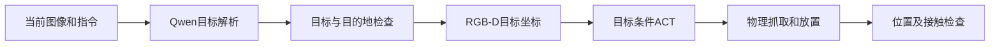

# 桌面自主拾取与分类放置：仿真系统及策略对照

日期：2026-10-15

本阶段围绕“把指定颜色方块放进指定盒子”搭建自主抓放原型。输入自然语言指令后，系统读取当前场景，解析目标与放置区，估计目标位置，执行抓放，并检查物体位置和接触状态。相比此前的单方块交接实验，这次将语言、视觉和动作统一到同一个桌面物理场景。

## 1. 场景与系统配置

场景包含红、蓝、绿三个方块和两个固定浅盒。方块颜色与位置随机交换，避免颜色固定对应位置。使用ViperX双臂模型，仅右臂执行抓放，左臂保持初始状态。

| 项目 | 配置 |
|---|---|
| 仿真 | MuJoCo2.3.7，dm-control1.0.14 |
| 物理周期 | 2ms，500Hz |
| 相机 | 固定俯视RGB与模拟深度，640×480 |
| 位置估计 | 颜色连通域、深度中位数、相机内外参反投影 |
| 语言模块 | Qwen3-VL-4B-Instruct＋任务选择LoRA |
| 动作模块 | 脚本几何基线、目标条件ACT两种方案 |
| ACT控制 | 25Hz命令；每25步重新预测动作块 |
| 动作表示 | 8维末端参考：xyz、wxyz四元数、夹爪开合 |

末端参考通过mocap约束驱动机器人，抓取依靠夹爪与物体的物理接触。末端约束相当于理想位置控制基线，未引入真实电机的力矩及速度限制。物体在执行过程中没有绑定到夹爪，也没有直接修改物体位置。这个接口用于当前模拟器，尚未映射到SO101关节驱动。

## 2. 几何抓放基线

首先使用已知物体位置执行接近、下探、闭合、抬升、平移、释放和撤离，再将已知位置替换为RGB-D估计结果。两种方案使用相同布局和目标组合。

初始斜向抓取在两组常规任务上均成功24/30，失败包括抓空和物体被推出桌面。将末端抓取方向改为垂直后，重新运行相同任务：

| 条件 | 成功 |
|---|---:|
| 已知位置，5布局×6任务 | 30/30 |
| RGB-D位置，5布局×6任务 | 30/30 |
| 方块半边长16/24/28mm，各6任务 | 18/18 |
| 摩擦系数0.4/0.7/1.3，各6任务 | 18/18 |

共96个任务均完成目标物体放盒。成功要求夹爪接触、物体抬升超过6cm、最终在指定盒子内满足末段1秒的采样稳定检查；另外核对盒底接触和末段夹爪无残留接触。

RGB-D常规组初始位置估计平均误差6.32mm、最大8.80mm。大尺寸组虽然完成放盒，但28mm半边长的6个任务中，4个推动了非目标物体超过10mm，最大位移12.28mm。因此“目标放盒成功”和“不干扰其他物体”需要分别统计。

这些任务共享固定相机、盒子位置和少量布局，不是96个独立复杂场景。结果用于确认物理执行链路和基本工作空间，不作为生产成功率。

## 3. 语言目标选择与LoRA

构建10个布局、100条图像指令，包括明确颜色/目的盒子、缺失颜色、含糊指令、否定操作和目标被移除的场景。基座模型的明确指令全部正确，但含糊指令会擅自选择目标和盒子。

| 基座测试 | 结果 |
|---|---:|
| 明确指令 | 60/60 |
| 所有用例的完整字段匹配 | 87/100 |
| 不应执行的用例中提出执行 | 10/40 |

针对这个问题，使用60条训练用例进行240更新的LoRA适配，冻结视觉模块，仅训练语言注意力q_proj/v_proj，r=8、alpha=16、学习率5e-5。布局seed400–405训练，406–407验证，408–409测试。

| 分组 | 基座 | LoRA |
|---|---:|---:|
| 验证20条，同指令模板的新布局 | 17/20 | 20/20 |
| 测试20条，同指令模板的新布局 | 18/20 | 20/20 |
| 44条未参与训练的新措辞 | 32/44 | 40/44 |

新措辞中，不应执行却提出执行的数量由12降到4。剩余错误均为“把蓝色方块放进盒子里”：模型仍默认选择左盒。这说明布局留出测试满分不代表语言泛化已经可靠。

启动器要求指令明确给出目标颜色和目的盒子，并核对模型建议是否一致。现场运行“把蓝色方块放进盒子里”时，LoRA仍建议左盒，但启动器返回待澄清状态，没有进入抓放。

## 4. 当前任务的示教数据与ACT

从成功的RGB-D脚本轨迹导出66条示教，共26466帧，25Hz、320×240。按布局划分54条训练、6条验证、6条测试；训练只覆盖4种布局，轨迹和帧之间存在较强相关性。

图像来自H264渲染视频，动作标签对应下一采样时刻的末端参考。它是当前桌面任务的数据，动作维度为8，不是此前ALOHA交接的14维关节动作，也不是人类遥操作数据。

两版ACT使用相同数据、训练次数和主要架构：ResNet18、256维Transformer、4头、2层编码器、动作块50、执行25步后更新。各训练10000更新，按验证误差选择权重。

| 配置 | 状态输入 | 最佳验证归一化L1 |
|---|---|---:|
| RGB版 | 6关节、夹爪、颜色/盒子任务符号，共12维 | 0.0332 |
| 坐标增强版 | 上述状态＋RGB-D测得的初始目标xyz，共15维 | 0.0281 |

开发阶段12个新任务的放置成功分别为3/12和12/12；坐标增强版进一步检查连续释放时有1个案例仍存在残留接触。随后冻结两版模型，在另外10个布局seed800–809、60个任务上做最终对照：

| 冻结模型 | 放置成功 | 释放及盒底接触复核 |
|---|---:|---:|
| RGB＋关节＋任务符号 | 20/60 | 20/60 |
| 加入RGB-D初始目标坐标 | 60/60 | 60/60 |

复核以相同float32类型和采样调用重放保存的动作，与原运行物体位置逐点一致，再检查末段接触。坐标增强版的收益表明，对于当前小样本、较小目标的任务，提供几何位置条件比仅依赖RGB特征更有效。两版只各训练一个随机种子，不能把差异完全归因于单一因素，也不能据此比较不同任务或不同数据集的优劣。

## 5. 定位误差敏感性

对冻结的坐标增强版，在同12个任务上为初始目标xyz加入各轴独立的零均值高斯扰动。这里的扰动是设定误差模型，不是实测相机噪声。

| 附加坐标扰动 | 放置成功 |
|---|---:|
| 无附加扰动 | 12/12 |
| 每轴σ=5mm | 10/12 |
| 每轴σ=10mm | 8/12 |

因此，理想深度条件下的高成功率不能直接迁移到真实单目相机。位置估计和坐标标定仍是主要接口；当前单目深度模型的未标定距离不能直接作为该策略的米制输入。

## 6. 在线流程与放置检查

已增加运行入口，现场读取当前模拟图像，调用Qwen和LoRA，完成目标检查与RGB-D定位，再由ACT控制同一场景中的机器人。新布局seed900上，“把蓝色方块放进左边盒子”完成抓取、放盒、释放和盒底接触检查。与前一阶段跨模拟器的流程不同，这里语言和动作处理的是同一场景。

另外，在12个语言测试任务中，将LoRA输出与ACT串接，12个明确任务均通过释放检查。动作阶段由RGB和关节反馈更新策略；语言只在开始时解析一次，没有多步任务重规划。语言推理期间仿真时钟暂停，当前流程未测量实时连续运行的端到端延迟。

视觉完成检查采用6个任务的操作前、夹持中、释放后三类图像对，共18条：

| Qwen检查方式 | 已完成案例中提出完成候选 | 未完成阶段误报完成 |
|---|---:|---:|
| 操作前/当前全图 | 0/6 | 0/12 |
| 增加左右盒子局部放大 | 4/6 | 1/12 |

全图方案全部返回不确定；局部图改善可见性，但仍误报一个夹持中的案例。当前完成判定采用模拟器位置与接触状态，Qwen视觉结果只作为候选观察，不触发下一次动作。

## 7. 结论与后续工作

当前已完成一个限定桌面任务的自主仿真原型，并得到对应任务的示教、目标选择适配器和动作策略。结果更支持分模块改进：先保证定位及物理抓放，再让学习策略利用明确的任务与几何条件；不能只靠延长训练，或把满分的简单用例当成泛化能力。

下一阶段优先扩大独立布局和相机条件，改变盒子位置、物体形状及遮挡；补充缺少目的地、多个同色目标等语言用例；验证定位误差下的策略表现和抓空后的停止/重试。当前策略固定盒子位置、使用模拟深度和末端约束控制。SO101迁移需另做坐标标定、动作接口与安全约束验证。

运行命令、模块说明和依赖见[README](README.md)。模型在 `runs/goal_lora/adapter`、`runs/goal_act_rgbd/best_checkpoint`，数据格式见 `data/demonstrations/manifest.json`。代码、模型和实验附件分别打包，便于复现与后续修改。
