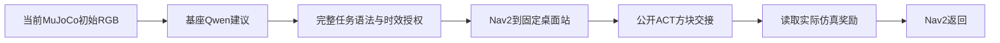

## ACT追加训练与更可靠的评测

延续自训练5,000更新的权重，再训练15,000更新，累计20,000。使用相同公开示教、40/5/5 episode划分、训练集统计、chunk100、batch8、学习率1e-4/backbone1e-5。**优化器重新初始化，不是包含优化器状态的无缝续训；没有载入公开ACT权重。** 该阶段训练耗时798.2秒，期间部分其他GPU实验同时运行，不能作为纯训练吞吐基准。

追加训练的最佳验证L1为0.2588，最终权重验证0.2850、测试64抽样帧L1为0.2909。最终权重的离线误差没有改善，因此以**验证集**选择best checkpoint，不能把最后一次更新自动当成最好模型。

使用另5个调参种子2000–2004，比较执行10/25/100动作后重新观察：成功分别2/5、1/5、4/5，选100。选择规则预设为成功数、平均最高奖励、相同则较长动作间隔。新测试种子3000–3029不参与选择；这里没有证明更频繁更新必然更好。

| 策略 | 同30个测试种子成功 | 说明 |
|---|---:|---|
| 原自训练5k最终权重 | 8/30（26.67%） | 与上一份交付保持一致的基线 |
| 原自训练5k最佳验证权重 | 8/30（26.67%） | 补充相同验证选模规则的对照 |
| 追加至20k最佳验证权重 | 16/30（53.33%） | 同样动作间隔100；提高8次，尚不稳定 |
| 公开预训练ACT | 25/30（83.33%） | 外部参考，不是自主训练成果 |

相对5k最佳验证模型，11个种子由失败变成功，3个由成功变失败；并非所有条件都改善。图中为95% Wilson区间，30次仍有较大不确定性。公开模型训练量及配置不同，不能作为公平训练消融。原10次结果与新30次用不同种子，分别报告，不用30次结果改写旧数据。

每次实际MuJoCo运行400步，保存动作、奖励与视频，以最高任务reward\(\geq\)4定义交接成功。离线验证误差不能代替这些成功率。多种子只覆盖当前模拟器的方块初始位置分布，不代表真实机器人或其他任务泛化。

## 独立于单条真实视频的RGB与深度评测

新生成30个MuJoCo场景，seeds4000–4029；红/蓝/绿方块各10场景，改变方块尺寸、位置与相机，生成120条目标指令及否定指令。每场景仍仅一个可见方块，背景结构基本一致，不是复杂真实场景。

标签来源为同一几何场景中目标材质黑/白两次渲染的差分可见像素，得到真实目标框；深度来自模拟器光学深度渲染，按米保存。标签不由被测Qwen生成。首次调用dm_control分割渲染出现索引错误，改用成对材质差分，明确保留方案与生成代码。

Qwen输入RGB和指令，输出目标可见性、归一化bbox与技能建议；后端根据预测框中心5\(\times\)5深度块取中位数。深度进入后端目标描述，**并未作为额外网络输入，也未实现相机到机械臂/地图外参**。

| 基座Qwen指标 | 120用例结果 |
|---|---:|
| 格式、目标可见性、技能建议匹配 | 各120/120 |
| 正例定位IoU\(\geq\)0.5 | 58/60 |
| 已检测正例平均IoU | 0.7032 |
| 框中心深度平均绝对误差 | 0.00057m |
| 否定指令技能匹配 | 30/30 |

深度误差很小，主要因模拟深度理想、方块可见、中心点通常落在目标面，不可当成真实深度精度/标定结果。120条来自30张图，存在共享图像与场景结构相关性，不能当成120个独立真实场景。技能匹配是接口建议测试；真正执行还须通过更严格的完整任务授权，不能仅因“红色可抓取”便执行完整交接。

## 新LoRA：按场景分组的定位适配

18/6/6场景划分训练/验证/测试，对应72/24/24指令。同图所有问法在同一组，不与训练混用。标签来自上述模拟器差分框及明确技能规则，不采用模型自标注。

冻结视觉模型，仅语言q_proj/v_proj使用r8、alpha16、dropout0.05、学习率5e-5，训练240更新，2,949,120可训练参数。仅监督回答token，核对输入前缀一致。独立进程重新加载保存适配器后，评估未参与训练的48条验证/测试用例。

| 分组 | 基座平均IoU | LoRA平均IoU | 可见性/技能匹配 |
|---|---:|---:|---|
| 验证12个正例 | 0.7281 | 0.8644 | 双方均24/24 |
| 测试12个正例 | 0.7254 | 0.8275 | 双方均24/24 |

这轮的定位框在模拟场景测试上改善，语义准确率本来已满分，未表现出额外提升。样本小、单方块、同模拟器，训练损失极低可能含记忆；不宣称真实世界或跨模拟器泛化。与上一轮单视频LoRA是两套独立数据/接口，旧结果继续保留，不能用新结果替代旧测试。

## 本机INT8与KV Cache实际对照

固定40条用例、相同模型/提示词/生成限制，训练及该阶段其他GPU模型结束后依次运行三组；每组独立进程加载，耗时分位数排除首次生成。未作多轮交错重复，因此数值是一次受控对照，不是稳定生产时延。

| 配置 | 加载后已分配显存GiB | 单次推理中位秒 | P95秒 | 目标/技能匹配 |
|---|---:|---:|---:|---|
| BF16＋KV Cache | 8.266 | 0.456 | 0.713 | 40/40 |
| 语言INT8＋KV Cache | 4.891 | 1.920 | 3.082 | 40/40 |
| BF16关闭KV Cache | 8.266 | 1.432 | 2.319 | 40/40 |

INT8转换252个语言Linear，视觉和lm_head未量化；显存下降约40.8%，但本机慢约4.2倍。关闭KV Cache也明显更慢。因此当前工作台仍保留BF16＋缓存，不把省显存当成加速。量化推理会发生BF16\(\rightarrow\)FP16的激活转换，记录在日志里。[Transformers量化说明](https://huggingface.co/docs/transformers/v4.57.0/quantization/bitsandbytes)

实际混合精度量化权重约5GB，已本地保存，新的进程从该目录直接加载并通过单例检查。它是**4090上验证的PC量化模型**，不是已验证的Jetson模型；不能推断Orin速度、功耗或ARM算子兼容性。

## Nav2、MoveIt与Qwen任务流程

Nav2使用实际Gazebo11/TurtleBot3、既有地图、AMCL、规划/控制节点；进入桌面站与返回两个action均完成。默认位置容差约0.25m，action成功不等于毫米级站点定位，odom记录不能直接当成map坐标误差。

MoveIt2使用独立domain63、Panda mock_components，3个合法关节目标均规划并模拟执行；另一个超界目标未找到有效目标状态，返回错误-27，没有执行。保留实际规划点和mock关节反馈。**这是模拟控制接口，未包含接触物理抓取**；MoveGroup返回executed_trajectory为空，不能捏造实际执行轨迹，反馈记录单独记录。

进一步实际跑通：

一次流程通过，原始图像、Qwen回复、授权、Nav2 action、ACT视频/奖励、返回和真实仿真rosbag均保存。使用**公开ACT及已知成功seed1003的接口冒烟测试**，不是自训练模型成功率，也不是未见种子泛化测试。

**Gazebo底盘和MuJoCo双臂位于独立模拟器，没有共同机器人模型/物理世界/外参；MoveIt是另一个独立规划接口。** 当前验证任务流程与模块交接，不称“一台移动机械臂完成同场景导航抓取”。Qwen只做一次高层建议，尚无持续完成状态视觉判断、重试或自主恢复。

## 可代测接口、失败记录及研究草稿

完整流程录制仿真ROS2 bag，共2364条消息，包含odom、scan、cmd_vel、clock、tf与tf_static；SQLite完整性检查通过。可作为后续代测收集/解析接口的演练，来源仍为模拟器。

任务授权只接受完整支持的交接指令，不匹配目标替换、否定、附加任务、只抓取请求、过期结果或取消；任一阶段失败停止后续派发。15项软件检查通过，不能当作15次实际机器人鲁棒性实验。

首次Nav2在生命周期激活前发goal被拒绝；第二次在AMCL初始定位之前等待导航active形成启动依赖，最终超时。已改为AMCL active\(\rightarrow\)initialpose\(\rightarrow\)bt_navigator active\(\rightarrow\)action，两个失败目录保留。shutdown日志中进程SIGINT/-2不是目标阶段的成功/失败判据。

技术论文草稿已围绕该阶段真实数据写成，注明工程复现、样本和创新边界。

下一步应优先同场景机器人与坐标系衔接、复杂目标及独立真实数据，再开展Jetson和企业代测；该阶段没有将可离线完成的准备工作写成未实际完成的硬件成果。